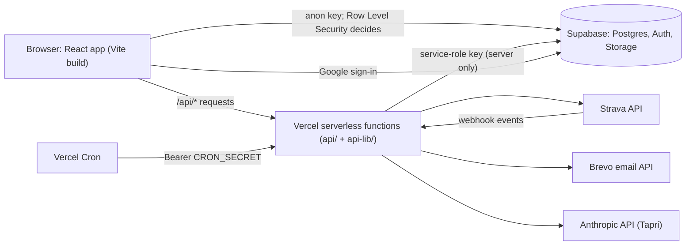

# Ride Tea GupShup (RTG): Complete Guide

A single reference for the RTG founders, the core team, and any developer or admin who joins the project. It starts with what RTG is and what people can do on the website, then goes step by step into how each part works, how to set it up, and how to run it day to day.

> **Where this comes from.** Everything here was read from the code repository (`ride-to-gupsup`, branch `pre-launch-fixes`, including the uncommitted work present on 2026-10-18): the code, `README.md`, the content files in `src/data/`, the SQL in `supabase/`, the serverless code in `api/` and `api-lib/`, and the two PDFs in `docs/`. Where something is unclear, disabled, or not built, this guide says so. Where the repo contradicts itself, section 10.3 lists it.
>
> **About wording and numbers.** Much of the site's text (taglines, stats, session times, prices) lives in `src/data/content.js` and similar files. That text is **default wording**: admins can replace most of it in **Admin → Site Content** without code. When this guide quotes it, treat it as "what the site says out of the box", not as a confirmed fact about the club today.

---

## Table of contents

1. [What RTG is](#1-what-rtg-is)
2. [The website at a glance](#2-the-website-at-a-glance)
3. [The member journey](#3-the-member-journey)
4. [Features in depth](#4-features-in-depth)
5. [The admin panel](#5-the-admin-panel)
6. [How it is built](#6-how-it-is-built)
7. [Emails](#7-emails)
8. [Setup and deployment](#8-setup-and-deployment)
9. [Day-to-day operations](#9-day-to-day-operations)
10. [Known gaps, contradictions and ideas](#10-known-gaps-contradictions-and-ideas)
11. [Glossary](#11-glossary)

---

## 1. What RTG is

### 1.1 In one paragraph

**Ride Tea GupShup (RTG)** describes itself as "India's endurance sports community for cycling, running, swimming, challenges, races, and unforgettable adventures." The name says the format: people ride (or run, or swim) together, then finish with **tea (chai)** and **gupshup** (Hindi for a relaxed chat). The default tagline is:

> **Ride Together. Run Together. Grow Together.**

### 1.2 Mission, vision and values (default wording)

- **Mission:** "Build an inclusive endurance community where people connect through sport, learn from one another, challenge themselves and create experiences that go beyond the finish line."
- **Vision:** "Build one of India's most trusted endurance communities — connecting cycling, running, triathlon and outdoor adventure through community, events, training and technology."
- **Core values:** Community First, Safety Always, Everyone Belongs, Grow Together, Consistency, Adventure.
- **Why RTG exists:** Move Together, Grow Together, Belong Together ("No ego. No pace-shaming. No unnecessary pressure.").

### 1.3 How it started (default wording)

The About page says RTG "wasn't created to build another competitive sports club", and that "what started as a handful of Friday morning rides has grown into a movement of 500+ athletes across India's cities." The default "RTG Journey" timeline reads:

| When | Milestone |
|---|---|
| Jan 2026 | RTG Begins |
| — | Community Rides and Runs |
| June 2026 | RTG Expands ("Beyond regular rides") |
| — | RTG Endurance League (pan-India virtual endurance challenge) |
| — | New Chapters and Communities: Delhi NCR, Dehradun, Chandigarh, Jaipur |
| — | What's Next: Races, Training, Adventures, Digital Community |

The "RTG in Motion" figures say **400+ Endurance League participants** in **one 4-week national challenge**.

### 1.4 Sports, cities and size (default wording)

- **Sports:** cycling, running, swimming, triathlon/brick training, and adventure (MTB trails, off-road).
- **Cities listed by default:** Delhi, Chandigarh, Dehradun, Jaipur, Shimla, Punjab, Pune, Mumbai.
- **States listed by default (13):** Delhi, Haryana, Uttar Pradesh, Uttarakhand, Punjab, Chandigarh, Rajasthan, West Bengal, Maharashtra, Gujarat, Karnataka, Telangana, Assam.
- **Home page stats (default):** 500+ active members, 13+ states, 70+ cities, 250,000+ total cycling km, 75,000+ total running km, 200+ rewards. These are typed-in numbers (editable in Admin → Site Content → Home → "Stats & Presence"), not calculated from data.
- **Base:** Delhi. Contact: `info@rideteagupshup.com`, `+91 99901 71239`.
- **Social:** Instagram, Facebook and YouTube (`@RideTeaGupShup`), plus a Strava club link.

### 1.5 Signature formats

These two formats appear across the Home page, Events, Calendar and the Lab:

| Format | What it is (default wording) |
|---|---|
| **Ridge Repeats** | "A signature RTG road-cycling format built around repeat loops." Saturdays, 5:00 AM, start at Talkatora Stadium (Delhi). Up to **5 loops of 9.15 km** (about 45 km). The idea is "**You vs You**": you are scored on improving against yourself. Run "in collaboration with @iRide2Reach" and "led by Manish Jayal". Marked "Exclusively under the RTG Membership Program" (paid session packs, see 4.12). |
| **Brick N Burn** (also "Friday Bricks") | A Friday 5:00 AM hybrid session: ride, then run straight after, then mobility. The Home page says "60 min ride + 30 min run"; the default Weekly Sessions list says "30 km cycling + 5 km run" at Nehru Park. The two default texts do not match; the live wording is whatever admins have saved. |

The default weekly schedule also lists a **Sunday Long Ride** (60–120 km), a **Wednesday Run Club** (Lodhi Garden) and a **Saturday Swim Clinic** (DLF Fort Pool), all marked "Free". These are fallback rows shown only until admins add real weekly sessions.

### 1.6 Community style

The default FAQ and guidelines stress: beginners welcome, "no athlete left behind", regroup often, pace to the slowest rider, helmets always, ride captains carry first aid. Joining the community and attending weekly rides/runs is described as free; paid things are some events, merchandise, the RTG Club membership and Ridge Repeats packs.

---

## 2. The website at a glance

The website is a single-page web app. The top navigation shows **Community, Calendar, Events, Lab, Membership, Store**, plus **Log In / Signup**, a shopping bag, and a live India-time (IST) clock. The other pages are linked from the footer (its columns are admin-editable).

### 2.1 Public pages

| Address | Page | What a visitor or member does there |
|---|---|---|
| `/` | Home | Hero carousel (Cycling, Running, Swimming, Community slides), stats and "Present Across India", Why RTG cards, Ways to Move, Training Formats (Ridge Repeats, Brick N Burn), Upcoming Events slides, Merchandise Highlights, Community Gallery, testimonials ("What People Say"), and the "Join the Movement" band with a small "Start the race" animation. The **Join Community** button starts the joining flow (3.2). |
| `/about` | About | Origin story, why RTG exists, journey timeline, mission and vision, what RTG offers, core values, "RTG in Motion" figures, the road ahead. |
| `/community` | Community | "Find Your Place" carousel, "The RTG Way" cards, "RTG in Motion" timeline, the RTG Network on an India map, and city photo rotations. Ends with a Join Community band. |
| `/weekly-rides` | Weekly Rides | The weekly session schedule, safety checklist, what to bring, ride FAQs. "Join This Ride" opens RTG's Strava club link. |
| `/weekly-rides/:slug` | One weekly session | Session details. "Join Now" opens the contact form pre-filled with the session name. |
| `/events` | Events | The event board: a rotating "Event Pulse", a spotlight, and every event, filterable by category (Flagship, Community, Virtual, Past). |
| `/events/:slug` | One event | Route description, Google map of the route, elevation, GPX link, results, previous edition, event photos, what to bring. "Register Interest" opens the contact page (there is no online event registration). |
| `/calendar` | Calendar | Live "calendar board", the Weekly Rhythm panel, and a month grid. Filter by activity type (for example `?category=cycling`). Each activity opens a detail window and can be downloaded as a calendar file (`.ics`). `/race-calendar` redirects here. |
| `/lab` | RTG Lab | The performance hub: reward periods and one card per lab. `/leaderboard` redirects here. |
| `/lab/strava` | RTG Club Lab | The Strava-fed challenge board (see 4.10). |
| `/lab/ridge` | Ridge Repeats Lab | Ridge Repeats rankings, charts, awards and photo cards (see 4.11). |
| `/membership` | Membership | RTG Club and Ridge Repeats session packs (see 4.12). |
| `/membership/checkout` | Membership checkout | Pay for a plan by UPI. Login required. |
| `/merchandise` | Store ("Drop Lab") | Products by category, Build Your Kit, Limited / Event Edition card, quick view, add to bag. |
| `/merchandise/:id` | Product page | One product with sizes and description. |
| `/checkout` | Checkout | Delivery details and UPI payment for the bag. Login required. |
| `/order-confirmation/:orderId` | Order confirmation | Confirms the order and shows the payment reference to be verified. |
| `/challenges` | Challenges | A list of challenges (display only; there is no sign-up or tracking on this page). |
| `/race-results` | Race Results | Past results, with a "Download Certificate" button where an admin uploaded one. |
| `/gallery` | Gallery | Photos and videos, filterable by category or "Videos", with a lightbox. |
| `/blog` | Blog ("From the Journal") | Post cards with title, category and excerpt. There is no page for reading a full post. |
| `/sponsors` | Sponsors | Why sponsor, current partners, opportunities, sponsorship packages, and a sponsor deck download (or "Request Sponsor Deck" via contact). |
| `/safety` | Safety | General safety guidelines and the weekly session checklist. |
| `/faq` | FAQ | General questions. |
| `/contact` | Contact | Contact form (saved for admins), email, phone and a map (hard-coded to Nehru Park, Delhi). |
| `/dashboard` | Member dashboard | Profile, Strava, memberships, orders, delete account (see 3.8). |
| `/privacy`, `/terms`, `/community-guidelines` | Legal pages | Text from `src/data/legalContent.js` (code-only; no admin screen). |
| anything else | Not found | A 404 page. |

### 2.2 Pages outside the normal layout

These draw their own full-screen frame (no navbar/footer, no intro video):

| Address | Purpose |
|---|---|
| `/auth/callback` | Where Google sign-in (and the Strava login flow) returns to finish signing in. |
| `/onboarding` | "Complete Your Profile", the community registration form after signup. |
| `/forgot-password` | Reset a password with an emailed 6-digit code. |
| `/reset-password` | Reset a password from the link in the same email. |
| `/admin/login` | Admin sign-in (not linked visibly; see 5.1). |
| `/admin/...` | The admin dashboard. |

### 2.3 Things every public page has

- **Intro video and 3D scene** (`Preloader`): plays on each fresh page load, with a **Skip Intro** button. Video file: `public/videos/rtg-intro.mp4` (a Mixkit stock clip, per the README).
- **Login panel** (`AuthGate`): appears after the intro for visitors who are not logged in, once per browser tab session. "Continue browsing without an account" closes it; the navbar's Log In reopens it.
- **Tapri**, the floating AI chat assistant (4.14).
- **Shopping bag drawer**.
- **Visitor counting** for Admin → Visitors (4.15).

---

## 3. The member journey

### 3.1 Ways to create an account

| Method | Status | How it works |
|---|---|---|
| **Email + password** (with name and phone) | Live | Sign Up tab of the login panel. The browser calls Supabase Auth directly. A database trigger creates the member's `profiles` row. If Supabase returns a session straight away, the member goes to `/onboarding`. |
| **Google** | Live | "Continue with Google" (Supabase OAuth). Returns to `/auth/callback`, then `/onboarding` if the profile is incomplete. |
| **Strava** | Connect only | There is **no "Continue with Strava" login button** in the current interface. Strava is linked to an existing account from the Dashboard or the RTG Club Lab (4.9). The server code for a Strava login flow still exists (`/api/auth/strava/start`) but nothing links to it. |
| **XFitConnect** | Not available | Code is prepared, but XFitConnect has no public OAuth API (per README), the credentials are blank, and no button is shown. |
| **Phone/SMS verification** | Deliberately not built | Every SMS provider charges per message, and Indian SMS needs DLT registration. Phone numbers are stored as contact details only. |

The signup form asks for **full name, phone (+91), email and password** (the panel accepts 6+ characters).

**Google and the Log In tab.** Google sign-in always succeeds, even for someone who has never registered (it creates the account). If someone chose **Log In** but the Google sign-in just created a brand-new account, `/auth/callback` signs them straight out and shows "You're new here", asking them to use **Sign Up**. The account record has already been created in Supabase at that point; the page only signs them out.

### 3.2 Joining the community ("Join Community")

The **Join Community** buttons (Home hero, Community page) behave differently depending on who clicks:

- **Not logged in:** the login panel opens first; after login the flow continues (remembered for a few minutes).
- **Logged in, not yet a member:** goes to the registration form `/onboarding`.
- **Already a member:** a small "you're already part of RTG" window.

A person counts as a community member once they submit `/onboarding` (`profiles.community_joined = true`).

### 3.3 Onboarding ("Complete Your Profile")

Shown once, right after a fresh signup. It mirrors RTG's original registration form:

| Field | Required? |
|---|---|
| Profile photo | Optional |
| Phone (+91) | Only if not already on file |
| Password + confirm | Only for Google sign-ins, so they can also log in by phone |
| City / Area, Date of birth, Age (filled from DOB) | Required |
| Gender (Male / Female) | Required |
| Rider, runner or both | Required |
| How often do you ride (Daily … Rarely) | Required |
| Do you have a Strava profile? | Required |
| Instagram ID, Blood group, Emergency contact (name and number) | Required |
| Medical conditions, Why you are joining | Optional |

Submitting sets `onboarding_complete` and `community_joined` on the profile. The wording on this page is editable in Admin → Site Content → Onboarding.

### 3.4 Logging in

The login panel offers:

- **Continue with Google.**
- **Email + password.**
- **Phone number + password.** Supabase cannot log in by phone without SMS, so the server looks up which email belongs to that phone (`profiles.phone`) and checks the password against it (`/api/auth/account?op=phone-login`). Wrong phone and wrong password give the same error, so the form does not reveal which phone numbers exist.
- **Email Code tab: built but switched off.** `OTP_LOGIN_ENABLED = false` in `src/components/AuthGate.jsx`. It would email a 6-digit code through Supabase's own mailer, which allows only about 2 emails per hour for the whole project. To turn it on: set up custom SMTP in Supabase (8.5), add `{{ .Token }}` to Supabase's Magic Link email template, then set the flag to `true`.

### 3.5 Remember me

A **Remember me** tick box sits on both the member and admin login forms, **ticked by default**.

- **Ticked:** the login is kept in the browser's `localStorage`, so it survives closing the browser and works across tabs.
- **Unticked:** the login is kept in `sessionStorage` (this tab only), which suits shared or public computers.

Changing the box moves an existing login between the two. The logic is in `src/lib/authStorage.js`. It replaced an older setup where everyone was logged out whenever they closed the tab.

### 3.6 Forgot password

RTG runs its own reset process instead of Supabase's mailer:

1. The member enters their email on `/forgot-password`.
2. The server (`api-lib/passwordReset.js`) emails, through **Brevo**, a **6-digit code and a reset link** in one branded email.
3. The member either types the code on the same page (it checks automatically on the sixth digit) or clicks the link, which opens `/reset-password`.
4. They set a new password (8 to 72 characters) and are **signed straight in**, then sent to their dashboard.

Rules built into the server:

| Rule | Value |
|---|---|
| Code and link expire after | 30 minutes |
| Use | Once; only the newest email's code/link is valid |
| Wait before asking again | 45 seconds |
| Requests per email per hour | 5 |
| Requests per network address per hour | 15 |
| Code checks allowed per email (right or wrong) | 8 (about six typos, since verify plus complete use two) |
| Stored | Only scrambled values (HMACs keyed by `OTP_SECRET`), never the code or link itself |

An address with no account gets a clear "No RTG account uses this email" error and no email is sent, so a typo is caught straight away. The per-email and per-IP rate limits still apply to these lookups. Accounts made through Strava have a placeholder email (`strava-<id>@members.rideteagupshup.com`) and cannot reset a password.

### 3.7 Welcome email

The first time a new member is signed in (email or Google signup), the site sends **one branded welcome email** through Brevo: "You're in, {first name}!", three first steps (complete your profile, connect Strava, show up for a weekly ride), links to Events, Challenges and the RTG Lab, the list of cities, and an Instagram link.

How "only once" is guaranteed:

- The browser (`src/lib/useWelcomeEmail.js`) asks the server once per device.
- The server (`api-lib/welcomeEmail.js`) stamps `profiles.welcome_email_sent_at` **before** sending, so two simultaneous requests cannot both send. If Brevo fails, the stamp is cleared so a later visit retries.
- Skipped: accounts older than 7 days, and Strava placeholder emails.
- Migration `022_welcome_email.sql` marks every member older than a week as already welcomed, so switching it on does not email the existing membership.

The email's images load from the live site (`public/images/email/`), so they only appear once the site is deployed and `FRONTEND_URL` points at it.

### 3.8 The member dashboard (`/dashboard`)

Logged-in members see:

- **Banner:** photo (click to change), name, city, sport, "Member since", an **RTG Club** badge if they hold an active Club membership, and "Strava connected". With Strava linked: total distance, activity count and moving time.
- **Connect Your Strava:** shown if Strava is configured and not yet linked.
- **My Memberships:** each purchase with status (Pending Verification, Active, Rejected, Expired, Cancelled) and validity date.
- **My Orders:** each Store order with status (Pending Verification, Confirmed, Rejected, Shipped, Delivered).
- **My Strava Activity:** recent synced activities, with a link to the RTG Club Lab.
- **Athlete Profile:** edit name, city, sport, bio, photo, DOB, age, gender, rider type, frequency, Instagram, blood group, emergency contact, medical conditions, reason for joining.
- **Delete My Account** (with a confirmation step).

### 3.9 Deleting an account

"Delete My Account" calls `/api/auth/delete-account`, which checks the member's own login and deletes their Supabase account. The database then removes, automatically: the profile, any admin seat, orders and order lines, Strava activities and totals, Lab registrations, and password-reset rows. Membership purchases, AI chat logs and visitor records are **kept, with the member link removed**. Contact messages are not linked to accounts and stay.

---

## 4. Features in depth

### 4.1 How content reaches the page (applies to almost everything)

Each public page starts by showing built-in default content from `src/data/*.js`, then loads the real rows from the database and swaps them in. Two patterns exist:

- **With fallback** (products, blog, challenges, testimonials, weekly sessions, FAQs, safety lists, sponsor tiers and opportunities, home cards, footer links, gallery): the defaults show **until the first row is added**. After that only database rows show. So the sample products disappear the moment an admin adds one real product. That is expected.
- **No fallback** (events, calendar, store categories, sponsors, all Community page lists, all Lab and Membership lists): only what admins have added is shown. An empty table means an empty section.

Most headings and paragraphs are stored in the `site_settings` table under keys like `text.<page>.<field>`, edited in Admin → Site Content. Images are in `site_images`, edited in Admin → Site Photos (defaults in `src/data/images.js`). Changes appear immediately; no redeploy is needed.

### 4.2 Events (`/events`, `/events/:slug`)

- Each event is a row in `events` (Admin → Events): title, URL slug, date/status text (free text such as "Coming Soon" or "Saturdays"), type, categories, prize pool (₹, a number), description, cover image, route description, route map (an address; the site embeds Google Maps for it), elevation, GPX link, results, previous edition, accent colour, category (**Flagship / Community / Virtual / Past**), and optional homepage-slide fields.
- **Featured** events become Home's Upcoming Events slides. Events in category **Past** are kept off Home's Upcoming list.
- Event pages show photos from the Gallery that an admin tagged with that event's slug.
- **Registration is not online.** The button is "Register Interest", which goes to the contact form.
- Migration 015 sets up three event pages that the Home buttons point to: `/events/ridge-repeats`, `/events/brick-and-burn`, `/events/strava-challenge`.

### 4.3 Calendar (`/calendar`)

- **Activity types** (`calendar_categories`, Admin → Calendar — Activity Types) give colours, legend pills and filter pills. A type can be kept for colour only ("Show as a filter" off).
- **Activities** (`calendar_activities`, Admin → Calendar — Activities) are one of three kinds: **weekly** (repeats on a weekday), **once** (one date), or **flexible** (no fixed day; shown only in the Weekly Rhythm panel). An activity can also appear under other types' filters (for example Brick and Burn under both Cycling and Running).
- Any activity can be downloaded as an `.ics` file that opens in Google Calendar, Apple Calendar or Outlook. This is generated in the browser; no service is involved.
- The login panel's "Live Today" box uses the same data: a weekly session on today's weekday, or a calendar entry dated today.

### 4.4 Weekly rides (`/weekly-rides`)

- Sessions come from `weekly_sessions` (Admin → Weekly Sessions): day, name, time, location, format, difficulty, pace groups, route map, cost, description. Each gets its own page at `/weekly-rides/<slug>`.
- The same page shows the **Ride Safety Checklist**, **What to Bring** and **Ride FAQs** lists (each its own admin screen).
- "Join This Ride" links to RTG's Strava club; a session's "Join Now" opens the contact form with the session name filled in.

### 4.5 Challenges (`/challenges`)

A simple list from the `challenges` table: title, period and description. Default examples include a Resolution Challenge, Monthly Distance Challenge, Elevation Challenge, Ride and Run Streaks and Virtual Competitions. **There is no sign-up, tracking or scoring for these challenges on the site.** Distance-based competition actually runs through the RTG Club Lab (4.10).

### 4.6 Race results (`/race-results`)

Rows from `race_results` (Admin → Race Results): event, athlete, category, finish time, position, year, and an optional certificate file that shows as "Download Certificate".

### 4.7 Leaderboard

The old Leaderboard page was replaced by the RTG Lab (migration 016); `/leaderboard` now redirects to `/lab`. The `leaderboard_stats` table still exists: it holds each Strava-connected member's running totals and feeds the totals on their own dashboard. The public competition board is the RTG Club Lab.

### 4.8 Community, gallery, blog, sponsors

- **Community page:** seven admin-managed lists (Find Your Place, The RTG Way, RTG in Motion, Network Groups, Network Map Pins, Cities, City Photos). No defaults: empty until admins add rows.
- **Gallery:** photos and videos uploaded in Admin → Gallery (several at once). Each can have a caption, category and an event tag. The page filters by category and "Videos".
- **Testimonials:** the "What People Say" slider on Home. The default quotes in `content.js` are placeholders.
- **Blog:** cards with title, category, excerpt and cover. The table has a `content` column, but no page displays full posts.
- **Sponsors:** current partners (logo, tier, website), opportunities and tiers. Default tiers: Title ₹5,00,000/year, Gold ₹2,00,000/year, Community ₹50,000/year. If an admin uploads a sponsor deck (Admin → Site Photos, `sponsor_deck_url`), the page shows "Download Sponsor Deck"; otherwise "Request Sponsor Deck" goes to the contact page.
- **Team:** Admin → Team manages a `team_members` table, but **no public page currently shows it** (the `useTeamMembers` hook is not used anywhere).

### 4.9 Strava integration

**What members get:** connect Strava once, and their rides and runs sync automatically to their dashboard and, if they register, to the RTG Club Lab board.

**Connecting** (Dashboard or `/lab/strava`):

1. The browser calls `POST /api/auth/strava/connect-start` with the member's login token.
2. The server signs the member's id into a short-lived cookie (HMAC with the service-role key) and returns Strava's approval URL.
3. Strava sends the member back to `/api/auth/strava/callback`. The server checks the OAuth `state` and the signed cookie, then saves the Strava tokens on **that** member's profile. Because of this, connecting cannot switch you into a different account. If that Strava athlete is already linked to another RTG member, the result is "already_linked".
4. It immediately pulls the **most recent page** (up to 200 activities) so the dashboard shows real numbers straight away.

Permissions requested: `read,activity:read_all` (this includes activities the athlete marked private on Strava, so their totals are correct; only aggregated totals are shown publicly).

**Keeping data current.** New rides reach the site three ways, so none depends on a single one, and nobody has to press Resync:

| Mechanism | File | What it does |
|---|---|---|
| **Webhook** (instant) | `api/webhooks/strava.js` | Only works once registered: **Admin → Members → Strava live updates → Turn on** (`api-lib/admin/strava-webhook.js`; it also shows which Vercel settings are missing). Strava calls it whenever a connected athlete creates, updates or deletes an activity. The server fetches that one activity, saves it, and recalculates the member's totals. Errors return a 500 so Strava retries; saving is keyed on the Strava activity id, so a retry never duplicates. |
| **Member opens the site** | `src/lib/useStravaRefresh.js` → `POST /api/auth/account?op=strava-refresh` (`api-lib/stravaRefresh.js`) | For a signed-in member with Strava, fetches only rides newer than the newest one saved (looking back one day for late uploads): one Strava request when nothing is new. At most every 10 minutes per member (`profiles.strava_checked_at`, migration 030). The Dashboard and leaderboard re-read when rides arrive. |
| **Backfill job** | `api/cron/strava-backfill.js` (scheduled **once a day**, 03:00 IST, in `vercel.json`) | Walks each member's **entire history** backwards, 200 activities per page, saving its position after every page (`profiles.strava_synced_through`) so an interrupted run resumes. Up to 25 members and about 45 seconds per run. Only an empty page from Strava ends a member's walk (a short page used to stop it early and leave older history out). When it passes a member's first ever activity, it marks them done (`strava_backfill_done`). If Strava's rate limit is hit, it stops and resumes next run. With the time left it then checks up to 60 members whose history is complete for **new** rides, longest-unchecked first (before this, a ride missed by the webhook never arrived). |
| **Admin resync** | `POST /api/admin/strava-resync` (Admin → Members → "Resync Strava") | Clears everyone's position and walks every connected member's full history again. The button keeps going (about 40 seconds per round) and shows progress until every member is done, usually within minutes; if Strava's rate limit is hit it says so, and pressing it again later (or the daily job) finishes the rest. |

Access tokens are refreshed automatically when within 5 minutes of expiry (`api-lib/stravaAuth.js`).

**Data storage:** each activity is a row in `strava_activities` (private: the member and admins only). After every change, the member's totals (distance, moving time, count) are recalculated into `leaderboard_stats`.

**Branding:** Strava's own logo and "Connect with Strava" button images are used (`src/components/lab/StravaBrand.jsx`), and the Lab marks Strava as the data source, as Strava's terms require.

**Not built:** a "Disconnect Strava" button, and handling of Strava's "athlete revoked access" webhook event (the webhook ignores non-activity events).

### 4.10 RTG Lab and the RTG Club Lab (Strava challenge board)

**`/lab`** is the hub. Its lab cards, reward-period strip, hero tiles and "More than a rank" principles are all admin tables. Two labs are set up by migration 016 (later renamed by 018):

| Lab | Default description |
|---|---|
| **RTG Club Lab** (`/lab/strava`) | "A year-round reason to show up. Track distance, speed and elevation… and celebrate top athletes in each category." Cycling and running, all India. |
| **Ridge Repeats** (`/lab/ridge`) | "One 9.15 km loop. Up to five chances to improve." |

**How the RTG Club Lab works:**

1. The page opens with an **access window**: log in, register for the lab, connect Strava. ("Explore dashboard", or `?view=board`, skips straight to the board.)
2. **Registering** (a row in `lab_registrations`) is the member's consent to appear on the public board. Members who have not registered are never shown.
3. The board is calculated by the database function `lab_strava_board()`, which totals the Strava activities of registered members for the chosen sport and period, plus activities an admin typed in by hand (Admin → Lab — Manual Activities, for athletes not on Strava). Only name, city, photo, gender and age come out; individual activities never do.
4. Until the first member registers, **sample athletes** fill the board and the page says so.

Board options (default set-up):

| Option | Values |
|---|---|
| Sports | Cycling (Strava types Ride, VirtualRide, EBikeRide, MountainBikeRide, GravelRide); Running (Run, TrailRun, VirtualRun; shown as pace) |
| Periods (India time) | Weekly, Monthly, Quarterly, Half-yearly, Yearly |
| Measures | Distance (km), Speed (km/h), Elevation (m) |
| Filters | Men / Women / all; age groups 18–34, 35–49, 50+ |
| Speed ranking qualifier | At least 3 activities, with an average of at least 10 km (cycling) or 3 km (running) per activity |

The board also shows change against the previous period, a head-to-head chart of the top three, and a **winner card maker**: the top three can create a shareable image (1080×1350 post or 1080×1920 story), drawn in the browser, then download it or share it.

### 4.11 Ridge Repeats Lab (`/lab/ridge`)

Results are **typed in by admins**, not taken from Strava:

- **Sessions** (Admin → Ridge Repeats — Sessions): one per Saturday.
- **Results** (Admin → Ridge Repeats — Results): one row per rider per session, with **loop times** such as `21:16, 20:58, 20:40`, plus optional spotlight and adjustment points and a photo.
- **Awards** (six by default): Session Leader, Endurance Standout, Fastest Lap, Biggest Improvement, Strong Finish, Most Consistent. **Spotlight** rows record who won them.

Scoring (calculated in the browser, `buildRidgeFeed()` in `src/lib/labData.js`):

- **Progress points:** for each loop after the first, the percentage improvement over the previous loop; these are added up. A session needs at least 2 loops (and no more than the maximum) to qualify.
- **Ridge points:** progress points + loops completed + spotlight points + adjustment points.
- Ranking modes: overall, progress, points and all-time. The page also shows progress-journey charts, a heatmap, each rider's record, and Spotlight awards.
- **Photo card maker:** a rider can make an Instagram post (4:5) or story (9:16) of their session, overall progress or award, optionally over their own photo (up to 25 MB). **The photo never leaves their device.**

The loop length and maximum number of loops are settings in Admin → Site Content → Ridge Repeats.

### 4.12 Membership (`/membership`)

Two products (default set-up from migration 016):

| Plan | Price | Notes |
|---|---|---|
| **RTG CLUB** | ₹100 / month | Perks: 20% off RTG paid events, 24-hour early booking access, 20% off the RTG Store |
| Ridge Repeats, 1 session | ₹250 (₹200 for Club members) | One-time |
| Ridge Repeats, 4 sessions | ₹800 | Valid 6 weeks from first attended session |
| Ridge Repeats, 8 sessions | ₹1,400 | 12 weeks |
| Ridge Repeats, 12 sessions | ₹2,000 | 18 weeks |
| Ridge Repeats, 16 sessions | ₹2,600 | 24 weeks |

**How buying works:**

1. The member picks a plan; "Your plan at a glance" summarises it; they go to `/membership/checkout?plan=<slug>` (login required).
2. They pay by UPI (deep link or QR) and type in the payment reference (UTR).
3. A `membership_purchases` row is saved as **Pending Verification**. The database rejects a self-made purchase that is already active, or priced below the plan's price.
4. An admin checks the UTR against the bank/UPI app and sets **Active** (Admin → Membership — Purchases). An active Club membership without an end date automatically runs for **one month**. For Ridge packs, the admin sets "Valid Until" and adds to "Sessions Used" at each attended session.

Purchases can be switched off by typing `closed` in the Membership "enrolment" setting (Site Content).

**Important:** the Club perks are **promises, not automation**. The Store checkout does not apply a 20% discount, and there is no online event booking where an event discount or early access could apply. Only the Ridge 1-session Club price is applied in code.

### 4.13 Store, bag and UPI checkout

- **Products** (Admin → Merchandise): name, price, photo, sizes, description, category tab, badge, accent colours, and flags for "Featured Drop", "Build Your Kit" and "Limited / Event Edition". **Categories** (Admin → Store — Categories) are the tabs.
- **Bag:** kept in the browser (`localStorage`), so guests can shop without logging in. The same product in a different size is a separate line.
- **Checkout (`/checkout`, login required):**
  1. Delivery details: name, phone, address, city, PIN code.
  2. Pay the total to RTG's UPI ID by tapping the UPI link (opens Google Pay, PhonePe, Paytm and so on) or scanning the QR code. The UPI ID and payee name are set in Admin → Site Content → Store → "Payment (self-hosted UPI)".
  3. Type in the UPI transaction reference (UTR) and place the order.
  4. The order and its lines are saved as **Pending Verification**; the bag empties; `/order-confirmation/<id>` shows the reference.
- **Admin → Orders:** check the UTR in the bank/UPI app and set Confirmed or Rejected, then Shipped and Delivered. The member sees the status on their dashboard.
- There is **no payment gateway** (no fees, no KYC), **no shipping charge** (total equals subtotal), **no stock tracking** beyond an "in stock" flag, and **no emails** about orders.
- Line items keep the product name and price as they were at order time, so later price changes do not alter past orders.

### 4.14 Tapri, the AI chat assistant

- A floating chat bubble on every public page. Default name **Tapri**; default greeting "Hey, I'm Tapri! Ask me about events, weekly rides, or tell me what you're looking for." Suggested prompts include "Find me a beginner cycling event" and "Suggest a training plan for a 10K".
- The browser sends messages to `POST /api/ai/chat`. The server adds a fresh snapshot of real data (up to 8 published events, 8 weekly sessions and 6 challenges) and asks **Claude Haiku** (`claude-haiku-4-5-20251001`, up to 600 tokens per reply, last 16 turns of history) through the Anthropic API.
- **Without `ANTHROPIC_API_KEY`** it runs in a free "basic mode": keyword answers about how many events there are, how to join, this week's sessions and challenges.
- **Settings** (Admin → AI Assistant): on/off switch, name, greeting, and extra instructions (system prompt). Stored in `site_settings` as `ai.*`.
- **Logging:** every message is saved (`ai_conversations`, `ai_messages`). A guest is identified by a random id in their browser; a logged-in member's chats are linked to them. Admins can read all conversations; members can read their own.
- These tables are created by `supabase/ai_schema.sql`, which is **separate** from `schema.sql` and must be run on its own.
- The Anthropic API is billed per message (per `api/.env.example`). The endpoint has **no rate limit** of its own.

### 4.15 Visitor statistics

- Every public page view is reported to the database function `track_site_visit()` (`src/lib/useVisitTracker.js`), plus a heartbeat every 30 seconds while the tab is visible. Admin pages, bots and automated browsers are not counted.
- What is stored: a random browser id, a random visit id, the page path, times, and (if logged in) which member. **No IP address, location or device details.**
- **Admin → Visitors** (`site_traffic()`) shows visits per day split into **Logged-in member**, **Looked and left** (one page, gone within 30 seconds) and **Browsed**, the most opened pages, and who is online now. It refreshes every 30 seconds.

### 4.16 Appearance settings

Admin → Appearance (sidebar group **Home & site**) works like a word processor:

| Setting | Options |
|---|---|
| Font | A list like WordPad's, each shown in its own typeface: Montserrat (RTG default), Space Grotesk, Arial, Verdana, Tahoma, Trebuchet MS, Segoe UI, System default, Times New Roman, Georgia, Courier New, and Google fonts Roboto, Open Sans, Lato, Poppins, Inter, Nunito, Raleway, Merriweather, Playfair Display (loaded only when used) |
| Size | A number in pixels: 8, 9, 10, 11, 12, 13, 14, 15, 16 (normal), 17, 18, 20, 22, 24, with A− / A+ buttons. Sizes under 12 and over 20 show a warning |
| Page by page | Every public page can have its own font and/or size, or follow the whole-site choice ("Site default"). A page's choice also covers the pages under it (an event's page follows Events) |
| Section by section | Open **Sections** on a page row to give one section (e.g. Community → The RTG Network) its own font and size, or follow the page ("Page font" / "Page size"). All normal text in that section changes; big display headings keep their designed size so layouts don't break. Sections are tagged in the code with `data-text-section` and listed in `SECTION_TEXT_TARGETS` (`src/lib/appearance.js`) |
| Colour | Default ink, High contrast, Softer; all contrast-checked against the light background (whole site) |

Size and font apply to body text; headings keep the RTG display font. The size scales the root font, so spacing grows with the text and layouts keep their shape. The admin panel itself is never restyled; the screen has a live preview instead. Nothing changes on the site until **Save changes**. Stored in `site_settings` as `text.theme.size`, `text.theme.font`, `text.theme.color` and `text.theme.pages` and `text.theme.sections` (JSON), and cached in the browser so pages don't flicker.

### 4.17 Contact form

`/contact` saves name, email, subject and message to `contact_messages`. Anyone can submit; only admins can read them in **Admin → Messages** (unread ones are bold, and the sidebar shows an unread count). **No email notification is sent** to anyone when a message arrives, and there is no reply-from-admin feature.

### 4.18 Newsletter

`src/components/sections/Newsletter.jsx` ("Never Miss a Ride") only shows a "You're on the list" message; **it saves nothing and sends nothing**. It is also **not placed on any page** at the moment (nothing imports it). There is no newsletter list, table or email provider integration. The same is true of `InstagramFeed.jsx` (placeholder tiles, not used).

### 4.19 Uploads and storage

- All admin uploads (site photos, gallery, cover images, logos, certificates) and member profile photos go to the public **Supabase Storage bucket `rtg-media`**, straight from the browser with an upload progress bar. Large photos are shrunk in the browser first. Supabase's free tier caps a single file at about 50 MB (comment in `src/lib/supabaseUpload.js`).
- Admins can write anywhere in the bucket. A member can only write inside `avatars/<their-user-id>/`. This is enforced by the database.
- **Replacing a Site Photo** does not delete the old file straight away: its address goes into `media_pending_deletions`, and a daily job (`api/cron/purge-media.js`, 03:00 UTC) deletes anything older than **2 days**. This leaves time to undo a mistake. Deleting a photo outright removes it immediately.
- The README's Cloudinary section is out of date: Cloudinary is no longer used (see 10.3).

---

### Live chat (/chat)

Logged-in members can talk to each other live, at **/chat** (also in the navbar, and through the round purple chat button that sits above the Tapri button on every page):

- **Community Room** — one room everyone can read. Plan rides, ask where people are.
- **Private messages** — one-to-one. Only the two people involved can read them; admins cannot.
- **Online now** — everyone with the site open right now, with a green dot. Admins carry an orange **ADMIN** badge (it comes from the database, so it can't be faked).
- **Unread** — the floating button shows a number for unread private messages and a dot for new room messages.
- **Moderation** — a member can remove their own room messages; an admin can remove anyone's and **mute** a member (they can still read, but not post or send messages). Everyone is limited to 5 messages per 10 seconds and 1,000 characters per message.

It runs on Supabase Realtime (no server functions, so it doesn't count toward Vercel's 12-function limit). The free Supabase plan allows about 200 people connected at once. Live location sharing on a map was discussed but is not built. Needs migration 025.

## 5. The admin panel

### 5.1 Getting access

- **Address:** `/admin/login`. There is no visible link. In the current uncommitted code, the navbar contains an **invisible** link to `/admin/login` (a transparent dot after Signup) for logged-out visitors; the README says such a dot was removed. Either way, hiding the link is not the protection.
- **The rule: the admins are 3 fixed email addresses**: `simranbaghelgame@gmail.com`, `shub88510@gmail.com` and `wheelikx@gmail.com` (migration 029, `api-lib/adminEmails.js`).
- Signing in at `/admin/login` with one of them (Google, or email/password once the email is confirmed) gives the account its `admin_profiles` row through `/api/auth/claim-bootstrap-admin`. Everyone else is refused ("Not an admin account").
- **Enforced three times:** the sign-in endpoint, `requireAdmin` on every admin API call, and the database (`is_admin()`, used by every security rule, plus the `admin_email_guard` trigger on `admin_profiles`).
- **Keep Supabase's "Confirm email" setting on.** The email must be verified, so nobody can sign up with an admin's address and their own password.
- **Changing the list** means editing `api-lib/adminEmails.js`, `admin_email_allowed()` in `supabase/schema.sql`, and running the new SQL in Supabase. The tests check that the lists match. There is no Revoke button.
- **One account, two roles:** an admin is a normal member with a seat. They use the same login.
- The email allowlist used by earlier versions (migrations 020 and 023) was removed in migration 024.

### 5.2 Every admin screen

The sidebar lists these screens (in this order). "Generic" screens share one list-and-form layout driven by `src/admin/resourceConfig.js`.

**Overview and people**

| Screen | Manages |
|---|---|
| Dashboard | Row counts for the main tables, with links |
| Visitors | Traffic statistics (4.15) |
| Members (`/admin/admins`) | Every member (name, email, phone, last login, joined), the 3 admin seats (with revoke), and **Resync Strava** |
| Messages | Contact form submissions; mark read, delete |
| AI Assistant | Tapri settings and conversation logs |

**Events and rides**

| Screen | Table |
|---|---|
| Events | `events` |
| Calendar — Activities | `calendar_activities` |
| Calendar — Activity Types | `calendar_categories` |
| Weekly Sessions | `weekly_sessions` |
| Ride Safety Checklist | `ride_safety` |
| What to Bring | `what_to_bring` |
| Ride FAQs | `ride_faqs` |

**Media, store and money**

| Screen | Table |
|---|---|
| Gallery (bespoke: multi-upload grid) | `gallery_items` |
| Merchandise | `products` |
| Store — Categories | `store_categories` |
| Orders (bespoke) | `orders`, `order_items` |

**Content**

| Screen | Table |
|---|---|
| Blog | `blog_posts` |
| Sponsors / Sponsor Tiers / Sponsorship Opportunities | `sponsors`, `sponsor_tiers`, `sponsor_opportunities` |
| Testimonials | `testimonials` |
| Challenges | `challenges` |
| Team | `team_members` (not shown on the public site) |
| Race Results | `race_results` |

**RTG Lab and Ridge Repeats**

| Screen | Table |
|---|---|
| Lab — Labs | `lab_programmes` |
| Lab — Reward Periods | `lab_periods` |
| Lab — Hero Tiles | `lab_highlights` |
| Lab — Principles | `lab_principles` |
| Lab — Access Steps | `lab_access_steps` |
| Lab — Sports | `lab_sports` |
| Lab — Age Categories | `lab_age_groups` |
| Lab — Manual Activities | `lab_activities` (hand-typed and sample athletes) |
| Ridge Repeats — Sessions / Results / Awards / Spotlight | `ridge_sessions`, `ridge_results`, `ridge_awards`, `ridge_spotlights` |

**Membership**

| Screen | Table |
|---|---|
| Membership — Plans | `membership_plans` |
| Membership — Club Perks | `membership_perks` |
| Membership — Which One | `membership_guides` |
| Membership — Steps | `membership_steps` |
| Membership — Questions | `membership_faqs` |
| Membership — Purchases | `membership_purchases` (verify payments, activate, track sessions used) |

**Community page**

| Screen | Table |
|---|---|
| Community — Find Your Place | `community_paths` |
| Community — The RTG Way | `community_principles` |
| Community — RTG in Motion | `community_milestones` |
| Community — Network Groups | `community_network_groups` |
| Community — Network Map Pins | `community_network_cities` |
| Community — Cities | `community_cities` |
| Community — City Photos | `community_city_moments` |

**Site-wide**

| Screen | What it manages |
|---|---|
| Site Photos (bespoke) | Every single image slot from `src/data/images.js` (Replace / Delete back to default), plus the sponsor deck file |
| Site Content (bespoke) | Headings, paragraphs, button labels and settings for Home, About, Events, Calendar, Store (including UPI ID and payee name), Community, Lab, Ridge Repeats, Membership, Onboarding, the Join band, Footer, and section headings on Blog, Challenges, Race Results, Safety, Sponsors and Weekly Rides |
| Appearance (bespoke) | Font and size in px, whole site and per page; text colour (4.16) |
| Home — Why RTG Cards | `home_why_reasons` |
| Home — Ways to Move Cards | `home_ways` |
| Home — Training Formats | `home_training_formats` |
| Footer Links | `footer_links` |
| FAQ | `faqs` |
| General Safety | `general_safety` |

### 5.3 What still needs a code change

These are read straight from code files and have no admin screen:

- About page lists: core values, "Why RTG Exists" cards, journey timeline, "How We Bring the Community Together" cards (`src/data/content.js`). The About paragraphs (how it started, mission and vision, RTG in Motion values, road ahead) **are** editable in Site Content.
- Contact page email and phone (`brand` in `content.js`) and the map location (hard-coded Nehru Park in `src/pages/Contact.jsx`). The footer's contact details are editable separately.
- Legal pages (`src/data/legalContent.js`).
- Welcome and reset email wording (`api-lib/welcomeEmail.js`, `api-lib/passwordReset.js`).
- The intro video file.

---

## 6. How it is built

### 6.1 Architecture

In words: the browser talks to Supabase **directly** for almost everything (reading content, saving profiles, placing orders), and the database's security rules decide what is allowed. A small set of jobs that need secrets (Strava, email, AI, admin grants, account deletion) go through Vercel serverless functions, which use the powerful service-role key that never reaches the browser.

### 6.2 Frontend

| Part | Detail |
|---|---|
| Framework | React 19, React Router 7, built with Vite 8 |
| Styling | Tailwind CSS v4 plus large hand-written sections in `src/index.css` and `src/styles/lab.css` |
| Animation and 3D | Framer Motion; Three.js through React Three Fiber/Drei (intro scene, lazy-loaded) |
| Icons | lucide-react |
| QR codes | `qrcode` package (UPI QR) |
| Data hooks | `src/lib/publicData.js` (public content), `src/lib/labData.js` (Lab, Ridge, Membership) |
| Admin area | `src/admin/`, loaded only when someone opens `/admin` |
| Lint / tests | `npm run lint` (oxlint). A Vitest test suite is being added in `tests/` (`npm test`); it was in progress at the time of writing |

Scripts in `package.json`: `dev` (Vite only; `/api` routes do not work), `build`, `preview`, `lint`, `test`, `start` (`node server.js`, see 10.3), and `postinstall`, which runs a production build after every `npm install`.

### 6.3 Serverless API endpoints

Vercel's Hobby plan allows **12 functions per deployment**, and `api/` is exactly at 12. That is why phone login, password reset and the welcome email share one function (`api/auth/account.js`), with their logic in `api-lib/`. **Adding any new file under `api/` would exceed the limit**; add a new `op` to `account.js` or merge functions instead.

| Path | Method | Purpose | Who may call it |
|---|---|---|---|
| `/api/auth/providers` | GET | Which OAuth providers are configured (`{strava, xfitconnect}`) | Anyone |
| `/api/auth/:provider/start` | GET | Start an OAuth login (Strava/XFitConnect) | Anyone; not linked from the UI |
| `/api/auth/:provider/connect-start` | POST | Start linking Strava to the logged-in account | Logged-in member (Bearer token) |
| `/api/auth/:provider/callback` | GET | OAuth return: link or create account; first page of Strava history | Browser returning from Strava (state cookie checked) |
| `/api/auth/account?op=phone-login` | POST | Phone + password to a session | Anyone (credentials checked) |
| `/api/auth/account?op=password-reset` | POST | `action`: `request`, `verify`, `complete` | Anyone (rate-limited) |
| `/api/auth/account?op=welcome` | POST | Send the welcome email once | Logged-in member |
| `/api/auth/claim-bootstrap-admin` | POST | Let one of the 3 fixed admin emails in (creates its admin row on first sign-in) | Logged-in member; 403 `not_admin_email` / `email_not_confirmed` for anyone else |
| `/api/auth/delete-account` | POST | Delete the caller's own account | Logged-in member |
| `/api/admin/strava-resync` | POST | Reset and re-walk Strava histories (all, or `userId`) | Admin only (checked on the server) |
| `/api/ai/chat` | POST | Tapri replies | Anyone (member token optional) |
| `/api/webhooks/strava` | GET / POST | GET: one-time Strava verification; POST: activity events | GET needs `STRAVA_WEBHOOK_VERIFY_TOKEN`; POST is open (Strava's format) |
| `/api/cron/strava-backfill` | scheduled | Walk Strava histories (daily); optional `?userId=` | `Authorization: Bearer <CRON_SECRET>` |
| `/api/cron/purge-media` | scheduled | Delete replaced photos older than 2 days (daily 03:00 UTC) | `Authorization: Bearer <CRON_SECRET>` |

Shared server code in `api-lib/`: `supabaseAdmin.js` (service-role client), `requireAdmin.js`, `providers.js`, `cookies.js`, `stravaAuth.js`, `stravaSync.js`, `storageDestroy.js`, `mailer.js` (Brevo), `emailLayout.js` (branded email frame), `passwordReset.js`, `welcomeEmail.js`, `phoneLogin.js`.

`vercel.json` sends every non-`/api` address to `index.html` (so deep links work), gives the backfill job up to 60 seconds, and defines the two schedules.

### 6.4 Database tables by area

All tables are in Supabase Postgres. `supabase/schema.sql` creates everything except the AI tables (`supabase/ai_schema.sql`).

| Area | Tables | Purpose |
|---|---|---|
| Accounts | `profiles` | One row per member: contact, registration answers, Strava tokens and sync position, onboarding/community flags, last login, welcome email stamp |
| Admin | `admin_profiles` | The 3 admin seats |
| Password reset | `password_reset_codes` | Scrambled reset codes and links, attempts, expiry; server-only |
| Site-wide | `site_settings`, `site_images`, `footer_links`, `media_pending_deletions` | Editable text and settings (key/value), image overrides, footer, photo deletion queue |
| Home | `home_why_reasons`, `home_ways`, `home_training_formats` | Home page cards |
| Events and calendar | `events`, `calendar_categories`, `calendar_activities`, `weekly_sessions` | Events board and pages, calendar, weekly schedule |
| Ride information | `faqs`, `ride_faqs`, `ride_safety`, `what_to_bring`, `general_safety` | FAQ and safety lists |
| Community | `community_paths`, `community_principles`, `community_milestones`, `community_network_cities`, `community_network_groups`, `community_cities`, `community_city_moments`, `testimonials`, `team_members`, `gallery_items` | Community page, testimonials, team, gallery |
| Results | `challenges`, `race_results` | Challenge list, race results |
| RTG Lab | `lab_programmes`, `lab_periods`, `lab_highlights`, `lab_principles`, `lab_access_steps`, `lab_sports`, `lab_age_groups`, `lab_activities`, `lab_registrations` | Lab hub and the RTG Club Lab board |
| Ridge Repeats | `ridge_sessions`, `ridge_results`, `ridge_awards`, `ridge_spotlights` | Ridge Repeats lab |
| Membership | `membership_plans`, `membership_perks`, `membership_guides`, `membership_steps`, `membership_faqs`, `membership_purchases` | Membership page and purchases |
| Store | `products`, `store_categories`, `orders`, `order_items` | Store and orders |
| Sponsors and blog | `sponsors`, `sponsor_tiers`, `sponsor_opportunities`, `blog_posts` | Sponsors page, blog |
| Strava | `strava_activities`, `leaderboard_stats` | Private activities; public per-member totals |
| Contact | `contact_messages` | Contact form submissions |
| Analytics | `site_sessions`, `site_page_views` | Visitor statistics |
| AI | `ai_conversations`, `ai_messages` | Tapri chat logs (from `ai_schema.sql`) |

Database functions: `is_admin()`, `handle_new_user()` (creates a profile on signup), `sync_last_login()`, `enforce_admin_seat_cap()`, `membership_purchase_defaults()` (one-month Club validity), `lab_strava_board()`, `track_site_visit()`, `site_traffic()`.

Common `site_settings` key families: `text.<page>.<field>` (page wording), `text.theme.*` (appearance), `text.home.stat.*`, `text.home.citiesList`, `text.home.statesList`, `payment.upiId`, `payment.payeeName`, `ai.enabled`, `ai.name`, `ai.greeting`, `ai.systemPrompt`, `sponsor_deck_url`.

### 6.5 Storage and scheduled jobs

| Item | Detail |
|---|---|
| Bucket | `rtg-media` (public read) |
| Who can write | Admins anywhere; members only `avatars/<their id>/` |
| Daily 03:00 UTC | `/api/cron/purge-media`: empties the photo deletion queue (items older than 2 days, up to 200 per run) |
| Daily, 03:00 IST | `/api/cron/strava-backfill`: advances up to 5 members' Strava history |

Both scheduled jobs **refuse to run** if `CRON_SECRET` is not set.

### 6.6 Security model

- **Row Level Security (RLS)** is on for every table. The browser uses only the public "anon" key, so the database rules are the real gatekeeper:
  - Content tables: anyone can read (only published rows, unless admin); only admins can write.
  - `profiles`: a member can read and update only their own row; admins can read all.
  - `orders` / `order_items`: members create and read only their own; only admins change status or delete.
  - `membership_purchases`: members create their own (only as pending, never below the plan price) and read their own; admins manage.
  - `lab_registrations`: members register and withdraw themselves.
  - `strava_activities`: the member and admins read; only the server writes. `leaderboard_stats`: public read, server writes.
  - `contact_messages`: anyone can submit; admins read and manage.
  - `site_sessions` / `site_page_views`: admins read; writes only through `track_site_visit()`.
  - `password_reset_codes`: RLS on with **no** rules, so only the server can touch it.
- **`is_admin()`** is true when the account holds one of the 3 admin seats, checked on every query.
- **Service-role key** (bypasses RLS) exists only in server environment variables, never in `VITE_*` variables.
- **OAuth safety:** a random `state` cookie on every flow; the Strava "connect" flow carries a signed, 10-minute ticket naming the member.
- **The admin interface is not the boundary.** `ProtectedRoute` and `useAdminSession` only decide what to show; opening `/admin` directly or calling the API by hand is refused by the database and server either way.

---

## 7. Emails

| Email | Sent by | Status | Notes |
|---|---|---|---|
| Password reset (code + link) | **Brevo API**, from the site's own code | Built (uncommitted work) | Needs migration 021 and Brevo settings |
| Welcome email | **Brevo API** | Built (uncommitted work) | Needs migration 022; once per member |
| Email Code login (6-digit) | **Supabase mailer** | Disabled (`OTP_LOGIN_ENABLED = false`) | Needs custom SMTP in Supabase first |
| Signup confirmation | **Supabase mailer** | Depends on Supabase's "Confirm email" setting | The code expects it **off** (see 10.3) |
| Order placed / order status | — | **Not built** | Members see status only on their dashboard |
| Membership purchase / activation | — | **Not built** | |
| New contact message alert | — | **Not built** | Admins must check Admin → Messages |
| Newsletter | — | **Not built** | Form saves nothing (4.18) |

**Limits (as stated in the repo):**

- Supabase's built-in mailer: about **2 emails per hour for the whole project**. The third person in an hour silently gets nothing.
- Brevo free plan: about **300 emails per day**, free, no expiry.
- The site's own reset limits are in 3.6.

**Design:** both Brevo emails use one branded frame (`api-lib/emailLayout.js`): purple header with the white RTG logo, an orange-to-lilac bar, white content card, and a footer with the logo mark, the tagline, social links and `info@rideteagupshup.com`. Built with tables and inline styles for Gmail, Outlook and Apple Mail. Images (`rtg-logo-white.png`, `rtg-logo-mark.png`, `welcome-hero.jpg`) load from `public/images/email/` on the live site.

**Sender:** `MAIL_FROM_EMAIL` (default `no-reply@rideteagupshup.com`) and `MAIL_FROM_NAME` (default "Ride Tea GupShup"). The sender address must be on a domain verified in Brevo with SPF and DKIM records, or emails go to spam.

---

## 8. Setup and deployment

### 8.1 Accounts needed

| Service | Used for | Required? |
|---|---|---|
| **Supabase** | Database, logins (email, Google), file storage | Yes |
| **Vercel** | Hosting the site, the `/api` functions and the scheduled jobs | Yes (the repo is built for it) |
| **GitHub** | Source code; Vercel deploys from it | Yes, per README |
| **Brevo** | Password reset and welcome emails; optionally Supabase SMTP | Yes, for password reset |
| **Google Cloud** (OAuth client) | "Continue with Google" through Supabase | If Google login is wanted |
| **Strava API application** | Connecting Strava, activity sync | If Strava features are wanted |
| **Anthropic** | Tapri's full AI replies | Optional (basic mode works without) |
| **Domain DNS access** | Brevo SPF/DKIM records, custom domain | Yes, for reliable email |

The repo does **not** document the Google OAuth set-up. From the code: Google is enabled as a provider in Supabase (Authentication → Providers), and sign-in returns to `<site>/auth/callback`, so that address must be allowed in Supabase's redirect URL settings. Confirm the exact steps in Supabase's own documentation.

### 8.2 Environment variables

**Frontend** (in `.env.local` locally; in Vercel for production). Safe to expose:

| Variable | What it does |
|---|---|
| `VITE_SUPABASE_URL` | Supabase project URL |
| `VITE_SUPABASE_ANON_KEY` | Supabase public "anon" key. **Also read by the server** for phone login (`api-lib/phoneLogin.js`), so it must be available to the functions too. It is missing from `api/.env.example`. |

**Server only** (in `api/.env.local` locally per README; Vercel → Settings → Environment Variables in production). Never prefix these with `VITE_`:

| Variable | What it does | If missing |
|---|---|---|
| `SUPABASE_URL` | Supabase project URL for the server | All server features fail ("server_misconfigured") |
| `SUPABASE_SERVICE_ROLE_KEY` | Master key that bypasses RLS; also signs the Strava connect cookie | Same |
| `FRONTEND_URL` | The live site address: OAuth return address, and the base for links and images in emails | OAuth returns to `/`; email links fall back to the request's host |
| `STRAVA_CLIENT_ID`, `STRAVA_CLIENT_SECRET` | Strava app credentials | Strava connect is hidden/unavailable |
| `STRAVA_WEBHOOK_VERIFY_TOKEN` | Any random string; used once when registering the webhook | Webhook registration fails |
| `CRON_SECRET` | Protects the two scheduled jobs (`openssl rand -hex 32`) | Both jobs refuse to run: Strava histories never fill in, old photos are never purged |
| `ANTHROPIC_API_KEY` | Tapri's AI replies | Tapri runs in basic mode |
| `BREVO_API_KEY` | Sends email through Brevo | Password reset and welcome email return "server_misconfigured" |
| `MAIL_FROM_EMAIL` | Sender address on a Brevo-verified domain | Same |
| `MAIL_FROM_NAME` | Sender name (optional) | Defaults to "Ride Tea GupShup" |
| `OTP_SECRET` | Long random string used to scramble reset codes; changing it invalidates codes already sent | Password reset returns "server_misconfigured" |
| `XFITCONNECT_CLIENT_ID`, `XFITCONNECT_CLIENT_SECRET`, `XFITCONNECT_AUTHORIZE_URL`, `XFITCONNECT_TOKEN_URL` | Future XFitConnect login | Leave blank |
| `NODE_ENV` | `production` adds the `Secure` flag to cookies (set by the host) | — |
| `PORT` | Only for `server.js` | — |

Copy `.env.example` to `.env.local` and `api/.env.example` to `api/.env.local`. Both are git-ignored (`*.local`).

### 8.3 Database set-up and migrations

**Fresh project:**

1. Supabase → SQL Editor → paste all of `supabase/schema.sql` → Run. It creates every table, rule, function, trigger and the `rtg-media` bucket. It is safe to re-run.
2. Run `supabase/ai_schema.sql` the same way (after `schema.sql`, since it uses `is_admin()`).
3. **Starter rows:** `schema.sql` inserts **no** content rows. The starter rows (Lab sports, reward periods, age groups, membership plans, Ridge awards, calendar types, Community lists, footer links and so on) are only in the numbered migrations. The repo does not document a fresh-install path for them. They are written to insert only into empty tables, but several migrations also copy or delete older data. **Test on a scratch Supabase project before running them on the real one.** Note that some of them insert **sample** data (for example seven starter events in 009 and made-up Ridge riders in 016) that should be replaced.

**Existing database:** run every migration you have not run yet, **in number order** (there is no `001`):

| # | What it does |
|---|---|
| 002 | Home "Why RTG" and "Ways to Move" card tables, with starter rows |
| 003 | Home Training Formats table; optional homepage-slide columns on events |
| 004 | **Deletes** columns and wording the rebuilt Home page no longer uses |
| 005 | Products: `eyebrow` line for Home cards (deletes an old heading) |
| 006 | **Deletes** old Home gallery/testimonials heading text |
| 007 | **Deletes** the old Home Sponsors band wording |
| 008 | Footer links table, with starter rows |
| 009 | Event categories (Flagship/Community/Virtual/Past), accent colour; seven starter events if none exist |
| 010 | Calendar's own two tables; **deletes** the old calendar data after copying it |
| 011 | Leaderboard tables (later replaced by 016); **deletes** old data |
| 012 | Community page's seven tables; **deletes** old saved wording |
| 013 | Store categories and new product fields; **deletes** old Store wording |
| 014 | Community membership flags, Adventure calendar type, Ways to Move links |
| 015 | Calendar multi-filter; the three event sub-pages |
| 016 | RTG Lab, Strava board, Ridge Repeats, Membership; **step 8 deletes data** (read first) |
| 017 | Visitor statistics |
| 018 | Renames "Strava Challenge" lab to "RTG Club Lab" |
| 019 | Full Strava history sync columns; re-queues every connected member |
| 020 | (Superseded by 024.) Added an admin email allowlist and the 3-seat cap |
| 021 | `password_reset_codes` table |
| 022 | `profiles.welcome_email_sent_at`; marks members older than a week as already welcomed |
| 024 | Removes the admin email allowlist (and 023's clean-up): admins are the first 3 people to sign in at `/admin/login`; `is_admin()` = holds a seat; 3-seat cap kept. Supersedes 020/023 — do not re-run 020 afterwards. |
| 027 | Ridge volunteer assignments survive an admin's removal (`assigned_by` set to empty) and are deleted with a deleted account. Run after Randeep's four `2026…` Ridge migrations. |
| 028 | RTG Crew roles: `volunteer_roles` (public) and `volunteer_role_drafts` (admins only). |
| 029 | Admins are 3 fixed emails: `admin_email_allowed()`, `is_admin()` requires a confirmed listed email, `admin_email_guard` trigger. **Deletes** admin rows of anyone not on the list. |
| 032 | Removes the ~13,000 made-up sample activities (18 fake athletes, `is_sample = true`) from Lab — Manual Activities; hand-entered activities stay. 016 no longer re-creates them. |
| 031 | Ridge repair: makes sure the single `ridge_workspace` / `ridge_publication` rows exist and moves their version past the newest `ridge_audit` entry. Fixes "Unable to load Ridge sessions", "Code or operation unavailable" and "Access or records changed" on every save. Deletes nothing; safe to re-run. |
| 030 | `profiles.strava_checked_at`: when a member was last checked for new Strava rides (member refresh and nightly job). |
| 025 | Live chat: `chat_messages` (community room), `direct_messages` (private, only the two people can read them), `chat_bans` (admin mutes), spam limit of 5 messages per 10 seconds, and Realtime streaming. |

Each file starts with a header explaining what it does. Read it before running, especially those marked "deletes".

### 8.4 Supabase dashboard settings

- **Authentication → Providers → Email:** the code (`schema.sql` and `AuthGate.jsx`) expects **"Confirm email" OFF**, so signup returns a session straight away and continues to `/onboarding`. (The README's older text says it is ON; see 10.3.)
- **Authentication → Providers → Google:** enable it if Google login is wanted.
- **Authentication → Policies:** Supabase's own password rules also apply when resetting.
- **Custom SMTP and Magic Link template:** only needed for the Email Code tab (8.5).

### 8.5 Email (Brevo) and DNS

1. Run migrations 021, 022, 024 and 025.
2. In Brevo, **verify the sending domain** (`rideteagupshup.com`) by adding the **SPF and DKIM** records Brevo shows you to the domain's DNS. The exact record values come from the Brevo dashboard; they are not in the repo. Without them, mail lands in spam, which looks exactly like the feature being broken.
3. Brevo → SMTP & API → API Keys → create a key.
4. In Vercel set `BREVO_API_KEY`, `MAIL_FROM_EMAIL` (an address on the verified domain), `MAIL_FROM_NAME` and `OTP_SECRET`. Redeploy.

**Optional, only for the Email Code login tab:** in Supabase → Authentication → Settings → SMTP, enter Brevo's SMTP details (`smtp-relay.brevo.com`, port 587, your login and SMTP key) with a sender on your domain; raise Authentication → Rate Limits → Emails (the README suggests 100/hour); add `{{ .Token }}` to the Magic Link template; then set `OTP_LOGIN_ENABLED = true`.

### 8.6 First admins

After migration 029, each of the 3 admin emails (`simranbaghelgame@gmail.com`, `shub88510@gmail.com` and `wheelikx@gmail.com`) signs in once at `/admin/login`. Nobody else can become an admin.

### 8.7 Strava set-up

1. Create an app at <https://developers.strava.com> (Strava → Settings → My API Application). Category "Community"; **Authorization Callback Domain** is the bare domain (no `https://`, no path; `localhost` for local testing).
2. Put the Client ID and Secret in `STRAVA_CLIENT_ID` / `STRAVA_CLIENT_SECRET`.
3. Set `STRAVA_WEBHOOK_VERIFY_TOKEN` and `CRON_SECRET`.
4. **After the site is live**, set `STRAVA_WEBHOOK_VERIFY_TOKEN` in Vercel (any long random text), redeploy, then press **Admin → Members → Strava live updates → Turn on live updates**. (Or run `node scripts/register-strava-webhook.mjs` once.) It reads `api/.env.local` and registers `https://rideteagupshup.com/api/webhooks/strava` (the address is hard-coded in the script; edit it if the domain differs). Strava allows only one subscription per app.

### 8.8 Deploying

1. Push the repo to GitHub.
2. Vercel → New Project → import the repo (Vite is detected).
3. Add all variables from both example files with real values.
4. Deploy. Then set the Strava callback domain to the live domain, register the webhook, and check that both cron jobs appear in Vercel.

**Local development:** `npm install`, then `npm run dev` for the frontend only (logins work; `/api` features do not), or `vercel dev` to run the site and the functions together.

**Note on the backfill schedule:** Vercel's Hobby plan only allows cron jobs that run once a day — an hourly schedule makes every deployment fail with "Hobby accounts are limited to daily cron jobs". The backfill therefore runs daily at 03:00 IST, so a long Strava history can take a few days to fill in completely (Admin → Members → Resync Strava advances it on demand). For faster catch-up without upgrading, a free external scheduler such as cron-job.org can call `/api/cron/strava-backfill` more often with the header `Authorization: Bearer <CRON_SECRET>`.

---

## 9. Day-to-day operations

### 9.1 Common admin tasks

| Task | Where |
|---|---|
| Add or edit an event | Admin → Events. Tick "Featured" to show it on Home; set category to Past when it is over. |
| Put an activity on the calendar | Admin → Calendar — Activities (choose weekly, once or flexible) |
| Change the weekly schedule | Admin → Weekly Sessions |
| Upload photos or videos | Admin → Gallery (tag with an event slug to show them on that event's page) |
| Change a banner or background image | Admin → Site Photos → Replace (the old file is kept 2 days) |
| Change headings or text | Admin → Site Content → choose the page → edit → Save |
| Set the UPI ID for payments | Admin → Site Content → Store → "Payment (self-hosted UPI)" |
| Verify a Store order | Admin → Orders: match the UTR and amount in your bank/UPI app, then set Confirmed or Rejected; later Shipped and Delivered |
| Verify a membership | Admin → Membership — Purchases: match the UTR, set Active; for Ridge packs set "Valid Until" and update "Sessions Used" |
| Enter Ridge Repeats results | Admin → Ridge Repeats — Sessions (create the Saturday), then Results (loop times as `mm:ss, mm:ss, …`), then Spotlight |
| Add a non-Strava athlete to the Club Lab | Admin → Lab — Manual Activities |
| Read contact messages | Admin → Messages |
| Turn Tapri off or change its name and tone | Admin → AI Assistant |
| Make text bigger or higher contrast | Admin → Appearance |
| See traffic | Admin → Visitors |

### 9.2 Adding or removing an admin

The admins are fixed to 3 email addresses. To change them, a developer edits `api-lib/adminEmails.js` and `admin_email_allowed()` in `supabase/schema.sql` (the tests check they match), and the same `create or replace function public.admin_email_allowed…` SQL is run in Supabase. Remove the old person's row with `delete from admin_profiles where id = '<their id>';`. The new person then signs in at `/admin/login`.

### 9.3 Changing images and text in code

- **Default images:** `src/data/images.js`. Either paste a hosted URL, or put a file in `public/images/` and reference it as `/images/name.jpg`. Admin uploads in Site Photos override these defaults.
- **Default wording:** `src/data/content.js`, `labContent.js`, `onboardingContent.js`, `legalContent.js`. Saved Site Content overrides the first three; legal text has no admin screen.

### 9.4 Troubleshooting

| Symptom | Likely cause and fix |
|---|---|
| Password reset email never arrives | Check `BREVO_API_KEY`, `MAIL_FROM_EMAIL` and `OTP_SECRET` in Vercel and redeploy; check the domain is verified in Brevo with SPF and DKIM; look in spam; check the Brevo daily limit (about 300); check Vercel function logs for `[auth/password-reset]`. Strava placeholder accounts cannot reset. |
| "Too many reset requests" | The per-email (5/hour) or per-network (15/hour) limit; wait an hour. |
| Welcome email not sent | Migration 022 not run, Brevo not configured, account older than 7 days, or already sent (`profiles.welcome_email_sent_at` set). Clearing that column (and the browser's `rtg_welcome_checked_<id>` entry) allows a retry. |
| Email images missing | `FRONTEND_URL` not set to the live site, or the site not yet deployed. |
| Strava totals too low | `CRON_SECRET` missing (the backfill refuses to run); the daily schedule not active; Strava rate limits (the job resumes). Use Admin → Members → Resync Strava. |
| New rides not appearing instantly | Admin → Members → Strava live updates shows whether the webhook is on and which settings are missing. Even when it's off, rides arrive when the member opens the site and in the nightly job. Check function logs for `[webhooks/strava]`. |
| "Connect Strava" not shown | `STRAVA_CLIENT_ID`/`SECRET` not set (`/api/auth/providers` reports `strava: false`). |
| "That Strava account is already connected to a different RTG member" | Each Strava athlete can be linked to only one RTG account. |
| Phone login always says incorrect | `VITE_SUPABASE_ANON_KEY` not available to the server functions, or the phone saved in the profile differs (stored as `+91…`). |
| Admin login says "All admin seats are taken" | 3 admins already exist. Revoke one in Admin → Members first. |
| "All 3 admin seats are in use" | Remove an admin in Members first. |
| "Couldn't reach the server to check admin status" | Running `npm run dev` (no `/api`); use `vercel dev` or the live site. |
| A deploy fails after adding an API file | The 12-function Hobby limit (6.3). Fold the new endpoint into `api/auth/account.js` as another `op`. |
| A section on the site is empty | Its table has no rows, and that section has no fallback (4.1). Add rows in the matching admin screen. |
| Sample products or quotes showing | That table is still empty; add the first real row. |
| Tapri answers in "basic mode" | `ANTHROPIC_API_KEY` not set. "Switched off" means `ai.enabled` is off in Admin → AI Assistant. |
| Old photos never deleted | `CRON_SECRET` missing, so `purge-media` refuses to run. |

---

## 10. Known gaps, contradictions and ideas

### 10.1 Built but disabled or unused

- **Email Code login tab:** complete, switched off (`OTP_LOGIN_ENABLED = false`) until Supabase uses custom SMTP.
- **Strava login ("Continue with Strava"):** server flow exists (`/api/auth/strava/start`), no button links to it. Strava is connect-only.
- **XFitConnect:** wired in code, no credentials, no button.
- **Newsletter section and Instagram feed:** components exist but are not on any page; the newsletter form stores nothing.
- **Team:** admin screen and table exist; no public page shows team members.
- **Blog post content:** stored, but there is no page to read a full post.

### 10.2 Missing pieces

- **No transactional emails** for orders, order status, membership purchase or activation, or new contact messages.
- **No newsletter** storage or sending.
- **No online event registration or ticketing:** events use "Register Interest" through the contact form.
- **Club perks are not automated:** no Store discount, no early booking.
- **No payment gateway:** all payments are manual UPI with a typed reference.
- **Order amounts are calculated in the browser.** The database only checks that an order belongs to the person placing it. Admins should compare the **amount received** with the item prices, not only the UTR.
- **Sample products cannot be ordered.** The built-in sample products have ids like `jersey`, but `order_items.product_id` must be a UUID, so the database would reject an order for them. Add real products before opening the Store.
- **No shipping charge or stock counts** in checkout.
- **No "Disconnect Strava"** button, and Strava "access revoked" events are ignored.
- **No phone or SMS verification** (deliberate: cost and DLT registration).
- **Tapri has no rate limit**, and each message costs money when the Anthropic key is set.
- **Tapri's challenge data is likely always empty:** `api/ai/chat.js` asks for `challenges.published` and `challenges.end_date`, but neither column exists in `schema.sql` or any migration, so that query should fail and Tapri gets no challenges.
- **No clean-up** of old `password_reset_codes` rows or visitor statistics; both tables grow indefinitely.
- **No starter-data path for a fresh install** (8.3).
- **Contact page map and contact details are hard-coded.**

### 10.3 Contradictions and out-of-date text in the repo

| Topic | One place says | The code does |
|---|---|---|
| File uploads | README section 4 says uploads go to **Cloudinary** via `/api/cloudinary/sign` and lists `CLOUDINARY_*` variables | Uploads go to **Supabase Storage** (`src/lib/supabaseUpload.js`); `api/cloudinary/` does not exist. Some comments in `schema.sql` (for `media_pending_deletions`) still mention Cloudinary. |
| `server.js` (`npm start`) | Meant as an alternative Express host (comments mention Hostinger) | It imports `./api/cloudinary/sign.js`, which does not exist, so `npm start` would fail at startup. It also only wires 4 routes. |
| Email confirmation | README: "currently ON (Supabase default)" | `schema.sql` and `AuthGate.jsx` expect it **OFF**. |
| Intro video | README: shows once per tab session | `Preloader.jsx`: plays on every fresh page load "by design". (The login panel is the once-per-session one.) |
| Strava login button | README describes "Continue with Strava" in the login panel | No such button; Strava is connect-only. |
| Admin link | README: the near-invisible dot after Sign Up "was removed" | Uncommitted `Navbar.jsx` adds an invisible `/admin/login` link back for logged-out visitors. |
| Admin dashboard | README "Notes": an admin dashboard "is planned but not yet built" | It is fully built. |
| Forms | README "Notes": newsletter and contact forms are "front-end only" | Contact saves to the database; newsletter does save nothing (and is not on any page). |
| Editable content | README: mission/values/FAQs/weekly ride details need code changes | FAQs and weekly sessions have admin screens; mission, vision and About paragraphs are in Site Content. Core values and some About lists are still code-only. |
| Logo file | README: `public/images/rtg-logo.svg` | The `public/images/` folder holds `rtg-logo-nav.png`, `rtg-logo-horizontal.png`, `rtg-logo-square.png`. |
| Function file names | `schema.sql` and migration 021 comments mention `api/auth/password-reset.js` and `/api/auth/phone-login` | Code is `api-lib/passwordReset.js` and `api-lib/phoneLogin.js`, served by `api/auth/account.js`. |
| Domain | Emails, scripts and synthetic addresses: `rideteagupshup.com` | README Strava section and `api/.env.example`: `ridetegupshup.in`. |
| Environment table | README lists `CLOUDINARY_*` and omits Brevo, `OTP_SECRET`, `CRON_SECRET`, `ANTHROPIC_API_KEY` | `api/.env.example` is the accurate list (plus `VITE_SUPABASE_ANON_KEY` on the server). |
| Password length | Signup form accepts 6+ characters | Reset requires 8 to 72. |
| Tapri basic mode | "sign up with email, phone, or Google" | Signup needs email **and** phone; there is no phone-only signup. |
| Friday Bricks | Home default: 60 min ride + 30 min run | Weekly Sessions default: 30 km cycling + 5 km run. |
| Forgot-password comment | `ForgotPassword.jsx`: Google accounts have a synthetic address | Only Strava/XFitConnect accounts do; Google accounts have real emails. |
| `docs/*.pdf` | Plans for an admin-only login and a Strava stats phase "not yet implemented" | Both were built and then extended. Treat the PDFs as history. |

### 10.4 Ideas (suggestions, not commitments)

- Send order and membership emails through the existing Brevo mailer (`api-lib/mailer.js`), as another `op` on `api/auth/account.js` to stay within 12 functions.
- Store newsletter sign-ups in a table, or connect Brevo's contact lists, and put the section back on the Home page.
- Email admins when a contact message arrives.
- Recalculate order totals in the database from product prices.
- Apply the Club Store discount automatically at checkout.
- Add a "Disconnect Strava" button and handle Strava's deauthorization event.
- Add a public Team section, or remove the unused admin screen.
- Add a blog post page (`/blog/:slug`).
- Rate-limit `/api/ai/chat`.
- Fix the README (Cloudinary, email confirmation, intro behaviour, Strava button, environment table) and remove or repair `server.js`.
- Add retention clean-up for visitor statistics and old reset codes.
- Document Google OAuth set-up and a fresh-install path for starter data.

---

## 11. Glossary

| Term | Meaning |
|---|---|
| **RTG** | Ride Tea GupShup |
| **GupShup** | Hindi for casual chat; the "tea and talk" after a session |
| **Chai** | Tea; the post-ride ritual |
| **Brick / Brick N Burn / Friday Bricks** | A ride followed immediately by a run; RTG's Friday session |
| **Ridge Repeats** | RTG's Saturday cycling format: up to 5 loops of a 9.15 km circuit, scored on self-improvement ("You vs You") |
| **RTG Club** | The paid monthly membership (₹100/month by default) with perks |
| **RTG Club Lab** | The Strava-based challenge board at `/lab/strava` (formerly "Strava Challenge") |
| **RTG Lab** | The performance hub at `/lab` that replaced the Leaderboard |
| **Session pack** | Prepaid Ridge Repeats sessions (1, 4, 8, 12 or 16) |
| **Spotlight** | Ridge Repeats session awards (Session Leader, Fastest Lap and others) |
| **Progress points** | Ridge Repeats score: total % improvement loop over loop |
| **Tapri** | The AI chat assistant's default name (changeable in Admin → AI Assistant) |
| **UPI** | India's Unified Payments Interface (Google Pay, PhonePe, Paytm and so on) |
| **UTR** | Unique Transaction Reference, the UPI payment reference a buyer types in |
| **DLT** | India's mandatory registration for sending commercial SMS |
| **Onboarding** | The "Complete Your Profile" registration form after signup |
| **Community member** | An account that has submitted onboarding (`community_joined`) |
| **Admin seat** | A row in `admin_profiles`; at most 3 |
| **Supabase** | Hosted Postgres database plus login and file storage |
| **RLS (Row Level Security)** | Database rules deciding who can read or change each row |
| **anon key / service-role key** | Supabase's public browser key / master server key that bypasses RLS |
| **Vercel** | The host for the site, the `/api` functions and the scheduled jobs |
| **Serverless function** | A file under `api/` that runs on demand on Vercel |
| **Cron job** | A scheduled function call (`vercel.json` → `crons`) |
| **Webhook** | Strava calling RTG's server whenever an athlete's activity changes |
| **Backfill** | Pulling a member's past Strava history, page by page |
| **Watermark** | How far back the backfill has reached (`strava_synced_through`) |
| **OAuth** | The "approve this app" sign-in flow used by Google and Strava |
| **Brevo** | The email service used for reset and welcome emails |
| **SPF / DKIM** | DNS records proving emails really come from your domain |
| **HMAC** | A keyed scramble; reset codes are stored only in this form |
| **Fallback / default content** | Built-in text and images shown until admins add their own |
| **Site Content / Site Photos** | Admin screens that override default wording and images |
| **`.ics`** | Standard calendar file format |
| **Slug** | The readable part of an address, e.g. `ridge-repeats` in `/events/ridge-repeats` |
